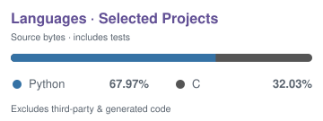

<h1 align="center">Hi there, I'm 千岚之夏 👋</h1>

  <em>Overthesky 遠くを見つめてる</em>

  With a background in music, I enjoy exploring where music, games, and technology meet— 
  and bringing ideas to life through AI-assisted development. 
  🌐 <a href="https://blueteemo.dinghongji0504.chatgpt.site">Personal Website</a>

  
  &nbsp;&nbsp;
  
  &nbsp;&nbsp;
  
  &nbsp;&nbsp;
  

## 🌱 Open Source

**AstrBot**  
Contributing to the AI assistant framework and its ecosystem. · [Contributions](https://github.com/AstrBotDevs/AstrBot/pulls?q=is%3Apr+author%3ABlueteemo)

**NgpCraft**  
Exploring netplay consistency and connection lifecycle issues. The maintainer adopted the synchronized-start idea I proposed in PR #26. · [Release notes](https://github.com/Tixul/Ngpcraft_emulator/releases/tag/v3.9.1)

## 🎮 Ports & Research

**CPyMO for NDS**  
Bringing CPyMO to Nintendo DS with enhanced dual-screen gameplay, video playback, and Windows/macOS game converters—tested on real hardware. · [Download & guide](https://github.com/Blueteemo/CPyMO/releases/tag/nds-v1.2.0)

**NGP / NGPC Research & Localization**  
Sharing research methods, localization tools, and reproducible case studies from *Memories Off Pure* and *INFINITY cure.* · [Explore](https://github.com/Blueteemo/ngp-localization)

## 🎵 Rhythm Games

**maimai Knowledge Skill**  
Song and chart lookup tools for AI agents. · [Repository](https://github.com/Blueteemo/maimai-knowledge-skill)

**Arcaea Knowledge Skill**  
Mechanics and story retrieval for AI agents. · [Repository](https://github.com/Blueteemo/arcaea-knowledge-skill)

## 🎧 Beyond the Code

Music is where I started. Rhythm games, visual novels, and old handhelds keep giving me new things to explore.

Sometimes that means a game port, sometimes a Chinese patch—and sometimes recording a soundtrack so it can be enjoyed beyond the game.

## ✍️ From My Blog

  <a href="https://blog.207723.xyz">
    <picture>
      <source media="(prefers-color-scheme: dark)" srcset="https://pic1.imgdb.cn/item/692359363203f7be0026c50c.png" />
      
    </picture>
  </a>

<!-- BLOG-POST-LIST:START -->
- [Windows 10 PowerShell 选不到 Consolas——conhost 的三层配置与 GBK 字体过滤](https://blog.207723.xyz/archives/windows-10-powershell-xuan-bu-dao-consolas----conhost-de-san-ceng-pei-zhi-yu-gbk-zi-ti-guo-lu) 

- [从用户到Contributor：我与AstrBot的故事](https://blog.207723.xyz/archives/cong-yong-hu-dao-contributor-wo-yu-astrbotde-gu-shi) 

- [Suno AI音乐生成初探：以午前二時の夢为例](https://blog.207723.xyz/archives/suno-aiyin-le-sheng-cheng-chu-tan-yi-wu-qian-er-shi-nomeng-wei-li) 

- [打造个性化GitHub主页：README美化实战指南](https://blog.207723.xyz/archives/da-zao-ge-xing-hua-githubzhu-ye-readmemei-hua-shi-zhan-zhi-nan) 

- [MarkText 汉化踩坑日志：当你以为改了 renderer.js 就够了](https://blog.207723.xyz/archives/marktext-han-hua-cai-keng-ri-zhi-dang-ni-yi-wei-gai-liao-renderer.js-jiu-gou-liao) 
<!-- BLOG-POST-LIST:END -->

## 📊 A Little More

Statistics &amp; languages

  <picture>
    <source media="(prefers-color-scheme: dark)" srcset="https://stats.programcx.cn/api?username=Blueteemo&show_icons=true&hide_border=true&hide_title=true&v=20261025&bg_color=00000000&text_color=9198a1&icon_color=b7a8df&title_color=b7a8df" />
    
  </picture>

  <picture>
    <source media="(prefers-color-scheme: dark)" srcset=".github/assets/languages-dark.svg" />
    
  </picture>

Contribution graph

  <picture>
    <source media="(prefers-color-scheme: dark)" srcset="https://github-readme-activity-graphkayan.vercel.app/graph?username=Blueteemo&theme=github-compact&bg_color=0d1117&color=9198a1&line=b7a8df&point=b7a8df&area=true&area_color=b7a8df&hide_border=true" />
    
  </picture>

Trophies

  <a href="https://github.com/ryo-ma/github-profile-trophy">
    <picture>
      <source media="(prefers-color-scheme: dark) and (max-width: 600px)" srcset=".github/assets/trophy-mobile-dark.svg" />
      <source media="(max-width: 600px)" srcset=".github/assets/trophy-mobile-light.svg" />
      <source media="(prefers-color-scheme: dark)" srcset=".github/assets/trophy.svg" />
      
    </picture>
  </a>

