<h1 align="center">Hi there, I'm 千岚之夏 👋</h1>

  <em>Overthesky 遠くを見つめてる</em>

  With a background in music, I enjoy exploring where music, games, and technology meet— 
  and bringing ideas to life through AI-assisted development.

  
  &nbsp;&nbsp;
  
  &nbsp;&nbsp;
  
    
  <a href="https://blog.207723.xyz">
    <picture>
      <source media="(prefers-color-scheme: dark)" srcset="https://pic1.imgdb.cn/item/692359363203f7be0026c50c.png" />
      
    </picture>
  </a>

## 🌱 Open Source

**AstrBot**  
Contributing to the AI assistant framework and its ecosystem. · [Contributions](https://github.com/AstrBotDevs/AstrBot/pulls?q=is%3Apr+author%3ABlueteemo)

**NgpCraft**  
Exploring netplay consistency and connection lifecycle issues. The maintainer adopted the synchronized-start idea I proposed in PR #26. · [Release notes](https://github.com/Tixul/Ngpcraft_emulator/releases/tag/v3.9.1)

## 🎮 Ports & Research

**CPyMO for NDS**  
Bringing CPyMO to Nintendo DS / DS Lite, with a game conversion assistant, a public release, and real-hardware testing. · [Download & guide](https://github.com/Blueteemo/CPyMO/releases/tag/nds-v1.1.0)

**NGP / NGPC Research & Localization**  
Sharing research methods, localization tools, and reproducible case studies from *Memories Off Pure* and *INFINITY cure.* · [Explore](https://github.com/Blueteemo/ngp-localization)

## 🎵 Rhythm Games

**maimai Knowledge Skill**  
Song and chart lookup tools for AI agents. · [Repository](https://github.com/Blueteemo/maimai-knowledge-skill)

**Arcaea Knowledge Skill**  
Mechanics and story retrieval for AI agents. · [Repository](https://github.com/Blueteemo/arcaea-knowledge-skill)

## 🎧 Beyond the Code

Music is where I started. Rhythm games, visual novels, and old handhelds keep giving me new things to explore.

Sometimes that means a game port, sometimes a Chinese patch—and sometimes recording a soundtrack so it can be enjoyed beyond the game.

## ✍️ From My Blog

从用户到 Contributor：我与 AstrBot 的故事 · [阅读](https://blog.207723.xyz/archives/cong-yong-hu-dao-contributor-wo-yu-astrbotde-gu-shi)

Suno AI 音乐生成初探：以午前二時の夢为例 · [阅读](https://blog.207723.xyz/archives/suno-aiyin-le-sheng-cheng-chu-tan-yi-wu-qian-er-shi-nomeng-wei-li)

## 📊 A Little More

Statistics &amp; languages

  <picture>
    <source media="(prefers-color-scheme: dark)" srcset="https://stats.programcx.cn/api?username=Blueteemo&show_icons=true&hide_border=true&hide_title=true&v=20261025&bg_color=00000000&text_color=9198a1&icon_color=b7a8df&title_color=b7a8df" />
    
  </picture>

  <picture>
    <source media="(prefers-color-scheme: dark)" srcset="https://stats.programcx.cn/api/top-langs/?username=Blueteemo&layout=compact&hide_border=true&bg_color=00000000&text_color=9198a1&title_color=b7a8df" />
    
  </picture>

Contribution graph

  <picture>
    <source media="(prefers-color-scheme: dark)" srcset="https://github-readme-activity-graphkayan.vercel.app/graph?username=Blueteemo&theme=github-compact&bg_color=0d1117&color=9198a1&line=b7a8df&point=b7a8df&area=true&area_color=b7a8df&hide_border=true" />
    
  </picture>

Trophies

  

